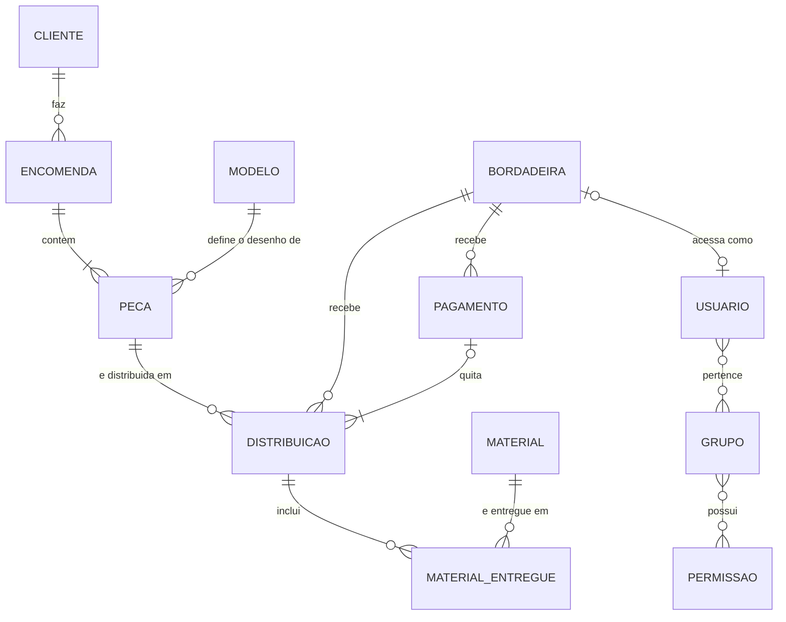

# Documento de Visão

Documento construído a partir do **Modelo BSI - Doc 001 - Documento de Visão**.

## Descrição do Projeto

O **Riscado** é um sistema web para gestão de encomendas em associações e ateliês de bordado da região do Seridó (RN).

Nessas associações, o trabalho funciona assim: um cliente faz uma encomenda (um enxoval, um jogo de toalhas, panos de prato), a coordenadora divide a encomenda em peças, risca o desenho no tecido e distribui as peças para bordadeiras que trabalham em casa. Cada bordadeira recebe o tecido e a linha, tem um prazo para devolver a peça bordada e é paga por peça entregue.

Hoje esse controle costuma ser feito em cadernos, o que gera atrasos percebidos tarde demais, erros e esquecimentos no pagamento das bordadeiras, falta de registro do material entregue e nenhuma visão de quanto trabalho a associação consegue assumir.

O Riscado organiza esse fluxo de ponta a ponta:

- cadastro de clientes, bordadeiras, modelos (riscos) e materiais;
- registro de encomendas e divisão em peças;
- distribuição das peças para as bordadeiras, com prazo e material entregue;
- acompanhamento de prazos, com destaque para as peças atrasadas;
- cálculo e registro dos pagamentos por peça.

O sistema é pensado para pessoas com pouca familiaridade com tecnologia: interface simples, poucos campos por tela e uso confortável no celular.

## Equipe e Definição de Papéis

| Membro | Papel | E-mail |
|---|---|---|
| Ícaro Nonato de Freitas | Product Owner, Scrum Master, Analista e Desenvolvedor | icaro.freitas.113@ufrn.edu.br |

### Matriz de Competências

| Membro | Competências |
|---|---|
| Ícaro Nonato de Freitas | Python, Django (básico), React + Expo (básico), Git/GitHub, gestão de projetos e de equipes, modelagem de negócios |

## Perfis dos Usuários

| Perfil | Descrição |
|---|---|
| Administrador | Responsável pela configuração do sistema. Gerencia usuários, grupos e permissões e tem acesso a todas as funcionalidades. |
| Coordenadora | Responsável pela operação da associação. Cadastra clientes, bordadeiras, modelos, materiais e encomendas, distribui as peças, registra devoluções e pagamentos e acompanha os prazos. |
| Bordadeira | Artesã que borda as peças em casa. Consulta as peças que estão com ela, os prazos de devolução e os pagamentos recebidos e a receber. |

## Lista de Requisitos Funcionais

### Entidade Bordadeira (US01 - Manter Bordadeira)

A bordadeira é a artesã que recebe as peças para bordar em casa. É identificada por um código e possui nome, telefone, comunidade ou bairro onde mora, especialidades (tipos de ponto que domina, como ponto cheio, rechilieu e ponto de cruz), data de cadastro e situação (ativa ou inativa).

| Requisito | Descrição | Ator |
|---|---|---|
| RF01.01 | Inserir bordadeira: informar nome, telefone, comunidade/bairro e especialidades. O código e a data de cadastro são gerados pelo sistema. | Coordenadora |
| RF01.02 | Listar bordadeiras, com filtro por nome, comunidade, especialidade e situação. A listagem mostra quantas peças cada bordadeira tem em mãos no momento. | Coordenadora |
| RF01.03 | Alterar os dados de uma bordadeira (nome, telefone, comunidade, especialidades e situação). | Coordenadora |
| RF01.04 | Excluir uma bordadeira pelo código. Só é permitido se ela não tiver distribuições registradas; caso tenha, a bordadeira deve ser marcada como inativa. | Coordenadora |
| RF01.05 | Consultar o histórico da bordadeira: peças recebidas, devolvidas, atrasadas e total pago. | Coordenadora, Bordadeira |

### Entidade Cliente (US02 - Manter Cliente)

O cliente é a pessoa ou empresa que faz encomendas à associação. Possui código, nome, telefone, e-mail, cidade e observações.

| Requisito | Descrição | Ator |
|---|---|---|
| RF02.01 | Inserir cliente: informar nome, telefone, e-mail, cidade e observações. | Coordenadora |
| RF02.02 | Listar clientes, com filtro por nome e cidade. | Coordenadora |
| RF02.03 | Alterar os dados de um cliente. | Coordenadora |
| RF02.04 | Excluir um cliente pelo código. Só é permitido se ele não tiver encomendas registradas. | Coordenadora |

### Entidade Modelo (US03 - Manter Modelo)

O modelo, chamado de "risco" pelas bordadeiras, é o desenho que será bordado. Possui código, nome, descrição, imagem do desenho, tipo de ponto, tempo médio de produção (em dias) e valor de mão de obra, que é o valor pago à bordadeira por peça bordada com aquele modelo.

| Requisito | Descrição | Ator |
|---|---|---|
| RF03.01 | Inserir modelo: informar nome, descrição, imagem, tipo de ponto, tempo médio de produção e valor de mão de obra. | Coordenadora |
| RF03.02 | Listar modelos com a imagem do desenho, com filtro por nome e tipo de ponto. | Coordenadora, Bordadeira |
| RF03.03 | Alterar os dados de um modelo. Alterar o valor de mão de obra não muda o valor de peças já distribuídas. | Coordenadora |
| RF03.04 | Excluir um modelo pelo código. Só é permitido se nenhuma peça usar o modelo. | Coordenadora |

### Entidade Material (US04 - Manter Material)

O material é o insumo entregue à bordadeira junto com a peça, como linhas e tecidos. Possui código, nome, tipo (linha, tecido ou outro), cor, unidade de medida (meada, metro, unidade) e quantidade em estoque.

| Requisito | Descrição | Ator |
|---|---|---|
| RF04.01 | Inserir material: informar nome, tipo, cor, unidade de medida e quantidade em estoque. | Coordenadora |
| RF04.02 | Listar materiais, com filtro por nome, tipo e cor, destacando os que estão com estoque baixo. | Coordenadora |
| RF04.03 | Alterar os dados de um material, inclusive a quantidade em estoque. | Coordenadora |
| RF04.04 | Excluir um material pelo código. Só é permitido se ele nunca tiver sido entregue em uma distribuição. | Coordenadora |

### Entidade Encomenda (US05 - Manter Encomenda)

A encomenda é o pedido feito por um cliente. Possui código, cliente, data do pedido, prazo de entrega, descrição, valor cobrado do cliente e situação (recebida, em produção, concluída, entregue ou cancelada).

| Requisito | Descrição | Ator |
|---|---|---|
| RF05.01 | Inserir encomenda: selecionar o cliente e informar data do pedido, prazo de entrega, descrição e valor cobrado. A situação inicial é "recebida". | Coordenadora |
| RF05.02 | Listar encomendas, com filtro por cliente, situação e período. Cada encomenda mostra o progresso (peças prontas / total de peças) e é destacada se o prazo estiver próximo ou vencido. | Coordenadora |
| RF05.03 | Alterar os dados de uma encomenda, inclusive a situação. | Coordenadora |
| RF05.04 | Excluir uma encomenda pelo código. Só é permitido se nenhuma peça dela tiver sido distribuída; caso contrário, a encomenda deve ser cancelada. | Coordenadora |

### Entidade Peça (US06 - Manter Peça)

A peça é cada item de uma encomenda que será bordado separadamente, por exemplo, "toalha de banho 3 de 6". Possui código, encomenda, modelo, descrição e situação (aguardando distribuição, em bordado ou pronta).

| Requisito | Descrição | Ator |
|---|---|---|
| RF06.01 | Inserir peças em uma encomenda: selecionar o modelo e informar a descrição e a quantidade. O sistema cria uma peça para cada unidade. | Coordenadora |
| RF06.02 | Listar as peças de uma encomenda, com filtro por modelo e situação. | Coordenadora |
| RF06.03 | Alterar a descrição e o modelo de uma peça que ainda não foi distribuída. | Coordenadora |
| RF06.04 | Excluir uma peça que ainda não foi distribuída. | Coordenadora |

### Entidade Distribuição (US07 - Manter Distribuição)

A distribuição registra a entrega de uma peça a uma bordadeira. Possui código, peça, bordadeira, data de saída, prazo de devolução, data de devolução, valor a pagar (copiado do valor de mão de obra do modelo no momento da distribuição), materiais entregues com suas quantidades e situação (com a bordadeira ou devolvida). Uma peça só pode ter uma distribuição em aberto por vez. Se for devolvida sem estar pronta, pode ser distribuída de novo.

| Requisito | Descrição | Ator |
|---|---|---|
| RF07.01 | Distribuir peça: selecionar a peça e a bordadeira, informar o prazo de devolução e os materiais entregues com as quantidades. O sistema registra a data de saída, calcula o valor a pagar, baixa os materiais do estoque e muda a peça para "em bordado". | Coordenadora |
| RF07.02 | Listar distribuições, com filtro por bordadeira, encomenda, situação e período, destacando as atrasadas (prazo vencido e peça ainda com a bordadeira). | Coordenadora |
| RF07.03 | Registrar devolução: informar a data de devolução e se a peça está pronta. Se estiver, a peça muda para "pronta"; se não, volta para "aguardando distribuição". | Coordenadora |
| RF07.04 | Alterar o prazo de devolução e os materiais de uma distribuição em aberto. | Coordenadora |
| RF07.05 | Excluir uma distribuição registrada por engano, desde que ainda esteja em aberto. Os materiais voltam ao estoque. | Coordenadora |
| RF07.06 | Consultar as próprias peças em aberto, com o prazo de cada uma. | Bordadeira |

### Entidade Pagamento (US08 - Manter Pagamento)

O pagamento registra o valor pago a uma bordadeira por uma ou mais peças devolvidas prontas. Possui código, bordadeira, data, forma de pagamento (dinheiro ou Pix), valor total e as distribuições que estão sendo quitadas. Cada distribuição só pode ser paga uma vez.

| Requisito | Descrição | Ator |
|---|---|---|
| RF08.01 | Registrar pagamento: selecionar a bordadeira, marcar as distribuições devolvidas prontas e ainda não pagas e informar a forma de pagamento. O sistema calcula o valor total. | Coordenadora |
| RF08.02 | Listar pagamentos, com filtro por bordadeira e período, e mostrar o total a pagar em aberto para cada bordadeira. | Coordenadora |
| RF08.03 | Alterar a data e a forma de um pagamento. | Coordenadora |
| RF08.04 | Excluir um pagamento registrado por engano. As distribuições voltam a ficar em aberto para pagamento. | Coordenadora |
| RF08.05 | Consultar os próprios pagamentos recebidos e o valor a receber. | Bordadeira |

### Entidade Usuário (US09 - Manter Usuário)

O usuário é a pessoa que acessa o sistema. Possui login, nome, e-mail, senha e grupos. Um usuário do grupo Bordadeira fica vinculado ao cadastro de uma bordadeira.

| Requisito | Descrição | Ator |
|---|---|---|
| RF09.01 | Inserir usuário: informar login, nome, e-mail, senha e grupos. Para o grupo Bordadeira, vincular ao cadastro da bordadeira. | Administrador |
| RF09.02 | Listar usuários, com filtro por nome, login e grupo. | Administrador |
| RF09.03 | Alterar os dados de um usuário, inclusive grupos e situação (ativo ou inativo). | Administrador |
| RF09.04 | Excluir um usuário pelo login. | Administrador |
| RF09.05 | Fazer login com login e senha. | Todos |
| RF09.06 | Fazer logout. | Todos |
| RF09.07 | Alterar a própria senha. | Todos |

### Entidade Grupo (US10 - Manter Grupo)

O grupo reúne usuários com o mesmo perfil (Administrador, Coordenadora, Bordadeira) e define as permissões de acesso de cada perfil.

| Requisito | Descrição | Ator |
|---|---|---|
| RF10.01 | Inserir grupo: informar nome e permissões. | Administrador |
| RF10.02 | Listar grupos e suas permissões. | Administrador |
| RF10.03 | Alterar o nome e as permissões de um grupo. | Administrador |
| RF10.04 | Excluir um grupo que não tenha usuários. | Administrador |

### Modelo Conceitual

#### Descrição das Entidades

| Entidade | Descrição |
|---|---|
| Cliente | Pessoa ou empresa que faz encomendas à associação. |
| Encomenda | Pedido de um cliente, com prazo de entrega e valor cobrado. |
| Peça | Item de uma encomenda que é bordado separadamente. |
| Modelo | Desenho (risco) a ser bordado, com tipo de ponto e valor de mão de obra por peça. |
| Bordadeira | Artesã que recebe as peças para bordar em casa. |
| Distribuição | Entrega de uma peça a uma bordadeira, com prazo, valor a pagar e materiais. |
| Material | Insumo (linha, tecido) controlado em estoque. |
| Material Entregue | Quantidade de um material entregue em uma distribuição. |
| Pagamento | Valor pago a uma bordadeira por uma ou mais distribuições concluídas. |
| Usuário | Pessoa que acessa o sistema. |
| Grupo | Perfil de acesso que reúne usuários e permissões. |
| Permissão | Ação que um grupo pode executar no sistema. |

## Lista de Requisitos Não-Funcionais

| Requisito | Descrição |
|---|---|
| RNF001 | O sistema deve ser acessível por navegador, funcionando nas versões atuais do Google Chrome e do Mozilla Firefox. |
| RNF002 | A interface deve ser responsiva e utilizável em celulares com tela a partir de 5 polegadas, já que a maioria das bordadeiras e coordenadoras usa apenas o celular. |
| RNF003 | A interface deve ser simples, voltada a usuários com pouca familiaridade digital: textos em português, fontes legíveis, botões grandes e poucos campos por tela. |
| RNF004 | As listagens devem carregar em até 2 segundos com até 5.000 registros. |
| RNF005 | O acesso deve ser feito com login e senha, e cada perfil só pode acessar as funcionalidades permitidas ao seu grupo. Uma bordadeira só vê os próprios dados. |
| RNF006 | Os dados pessoais (nome, telefone, endereço) devem ser acessíveis apenas a usuários autorizados, em conformidade com a LGPD. |
| RNF007 | O sistema deve registrar em log os acessos e as operações de inclusão, alteração e exclusão, com usuário e data/hora. |

## Riscos

| Data | Risco | Prioridade | Responsável | Status | Providência/Solução |
|---|---|---|---|---|---|
| 26/11/2026 | Conhecimento ainda básico em Django | Alta | Ícaro | Vigente | Começar pelo CRUD mais simples (Bordadeira), seguir a documentação oficial e usar as views genéricas do Django. |
| 26/11/2026 | Prazo curto e equipe de uma pessoa | Alta | Ícaro | Vigente | Priorizar o backlog: documentos e um CRUD completo primeiro; demais funcionalidades em sprints seguintes. |
| 26/11/2026 | Escopo grande demais para o tempo da disciplina | Média | Ícaro | Vigente | Manter o escopo da entrega restrito ao que está no backlog da sprint; registrar o restante como issues futuras. |
| 26/11/2026 | Falta de contato com uma associação real para validar o fluxo | Média | Ícaro | Vigente | Buscar uma conversa com uma associação de bordadeiras de Caicó para validar requisitos e regras. |
| 26/11/2026 | Baixa familiaridade dos usuários finais com tecnologia | Média | Ícaro | Vigente | Testar as telas com usuários reais e simplificar a interface com base no retorno. |

### Referências

- Modelo de Documento de Visão: <https://github.com/tacianosilva/engenharia-software/blob/main/docs/doc-visao.md>
- Documentação do Django: <https://docs.djangoproject.com/>
- Diagramas ER em Mermaid: <https://mermaid.js.org/syntax/entityRelationshipDiagram.html>